  
  
  
  

I'm **Wiktor Jeleń**, a backend and platform engineer based in Cracow, Poland. I build multi-tenant production systems, infrastructure and security-critical backends, and I wrote [PythonMetaTrader5](https://github.com/Akinzou/MetaTrader5-Python), an open-source library with over 43,000 PyPI downloads.

I start from architecture, invariants and failure modes, then write the code and prove it with tests and CI. I work AI-native every day with Claude Code, OpenAI Codex and Antigravity.

Most of my commercial code is in private client repositories; [yelon.dev](https://yelon.dev) describes those systems.

> **Open to new roles:** backend, platform or automation engineering, in Cracow or remote. Write to [root@yelon.dev](mailto:root@yelon.dev).

## Open source

**Contributions**

| Project | What I did |
| --- | --- |
| [**ros2_medkit**](https://github.com/selfpatch/ros2_medkit)  | Diagnostics gateway for ROS 2 robots (C++). [Merged fix](https://github.com/selfpatch/ros2_medkit/pull/775) in the fault manager: a snapshot topic whose publisher starts after the node used to be skipped for good; now it is picked up as soon as the graph reports its type. |
| [**pytripgui**](https://github.com/pytrip/pytripgui)  | GUI for PyTRiP, radiotherapy treatment planning with ions (Python). Moved the plan and field models to Pythonic properties as part of the MVC refactor. |

**My projects**

| Project | What it does |
| --- | --- |
| [**PythonMetaTrader5**](https://github.com/Akinzou/MetaTrader5-Python) | Python layer over the MetaTrader 5 API for algorithmic trading: order normalization, full retcode handling, safeguards for live accounts.   |
| [**TradeLockerBot**](https://github.com/Akinzou/TradeLockerBot) | FastAPI service that turns TradingView alerts into TradeLocker orders. The webhook path is a random secret printed once at startup. Docker image built by GitHub Actions. |
| [**CapitalCom**](https://github.com/Akinzou/CapitalCom) | Python client for the Capital.com API.   |
| [**TradingViewBacktester**](https://github.com/Akinzou/TradingViewBacktester) | Backtester for TradingView strategies in Python. |

## Stack

Stack as text

- **Backend & data:** TypeScript, Node.js, NestJS, Python, FastAPI, Django / DRF, PHP / Laravel, PostgreSQL, MySQL, MongoDB, Redis, Temporal.io
- **Platform & infra:** Linux, Docker, Kubernetes, Terraform, Nginx, AWS, GCP, Azure, GitHub Actions, GitLab, Hetzner
- **Architecture & security:** multi-tenant isolation, PostgreSQL RLS, Clean Architecture / DDD, TDD, OWASP ASVS, LDAP / AD, JWT, Semgrep
- **AI & automation:** Claude / OpenAI / Gemini APIs, MCP, RAG / vector search, LangChain / LangGraph, LLM evals, Playwright, n8n, Whisper
- **Also:** React, Next.js, Vue.js, C++, embedded / Klipper, Fusion 360

---

Jeleń is Polish for deer, and Yelon is roughly how it sounds in English. The banner and stack graphics are plain SVG files in this repo, generated by <code>scripts/gen.py</code>.
